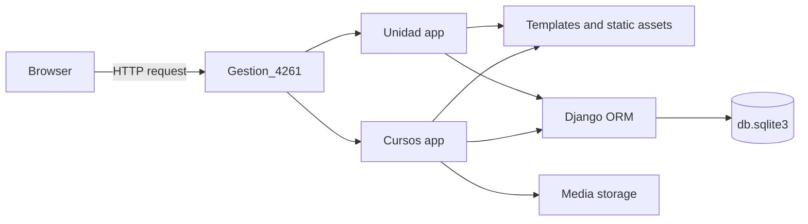
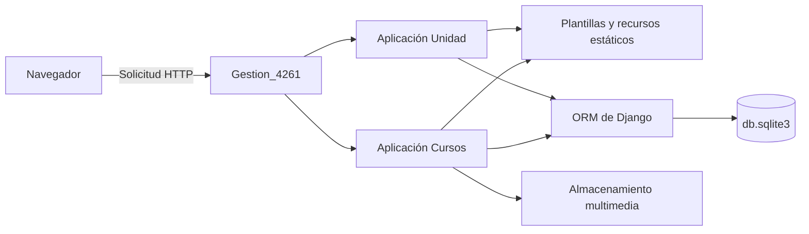

# Gestion 4261

[](https://www.python.org/)
[](https://www.djangoproject.com/)
[](https://www.sqlite.org/)


**Bilingual project guide / Guía bilingüe del proyecto**

> A Django application for managing military-unit information, training courses,
> students, enrollments, grades, and related records.
>
> Aplicación Django para gestionar información de la unidad militar, cursos,
> estudiantes, matrículas, calificaciones y registros relacionados.

## Contents / Contenido

- [English](#english)
- [Español](#español)
- [Architecture / Arquitectura](#architecture)
- [Usage example / Ejemplo de uso](#usage-example)
- [Operations / Operación](#operations)

---

## English

### Overview

Gestion 4261 is a server-rendered Django web application with two Django apps:

- **Unidad** provides the public-facing unit website and manages officer and
  postgraduate records.
- **Cursos** provides course, student, enrollment, grade, and administrative
  workflows.

The interface and much of the application content are in Spanish. The project
uses SQLite by default and includes a `db.sqlite3` database file.

### Architecture

The application follows Django's request/response and Model-View-Template
patterns. The project URL configuration delegates requests to the `Unidad` and
`Cursos` apps; each app contains its own models, views, templates, migrations,
and static assets.



| Layer | Responsibility |
| --- | --- |
| Browser | Renders HTML/CSS/JavaScript and captures student photos when camera access is granted. |
| `Gestion_4261` | Project settings, middleware, root URL routing, SQLite, and media/static configuration. |
| `Unidad` | Public unit pages and officer/postgraduate records. |
| `Cursos` | Courses, students, enrollment, grades, photo workflows, QR codes, and certificates. |
| Django ORM | Maps application models to the configured relational database. |
| `Media/` | Stores uploaded student photos and generated files; it is separate from versioned static assets. |

### Main features

- Public unit information pages, including the home page, history, schedule,
  gallery, events, and organizational information.
- Officer and postgraduate record management.
- Course creation and management, including active/closed course workflows.
- Student records, search, and course-based listings.
- Student enrollment and military-unit assignment.
- Grade entry, evaluation summaries, final grades, and lists of approved or
  unapproved students.
- Student photos captured through the browser camera or uploaded from a file.
- QR-code generation and image-based certificates.
- Django authentication, session management, and the Django admin site.

### Technology and libraries

| Component | Purpose |
| --- | --- |
| Python 3.12 | Recommended runtime for local development. |
| Django | Web framework, routing, templates, authentication, ORM, and admin. |
| SQLite | Default relational database (`db.sqlite3`). |
| NumPy | Imported by the course application. |
| OpenCV (`opencv-python`) | Computer-vision and camera-related functionality. |
| Pillow (`PIL`) | Image loading, processing, and certificate rendering. |
| `qrcode[pil]` | QR-code creation, including Pillow image support. |
| `python-dateutil` | Date parsing used by the Unidad application. |
| HTML, CSS, JavaScript | Browser interface and camera capture. |

Python dependencies are listed in `Gestion_4261/requirements.txt` and
`Unidad/requirements.txt`. The manifests are unpinned; installing them may
select newer compatible releases.

### Requirements

- Windows 10/11 (commands below use PowerShell).
- Python 3.12 with the Python launcher (`py`).
- Internet access to download Python packages.

### Installation and local setup

Run these commands from the project root (the directory containing
`manage.py`):

```powershell
py -3.12 -m venv .venv
.\.venv\Scripts\Activate.ps1
py -m pip install --upgrade pip
py -m pip install -r Gestion_4261\requirements.txt -r Unidad\requirements.txt
py manage.py migrate
```

If PowerShell prevents virtual-environment activation, either allow activation
for your user according to your organization's policy or invoke the environment
interpreter directly:

```powershell
.\.venv\Scripts\python.exe -m pip install -r Gestion_4261\requirements.txt -r Unidad\requirements.txt
.\.venv\Scripts\python.exe manage.py migrate
```

Create an administrative account if needed:

```powershell
py manage.py createsuperuser
```

### Run the development server

```powershell
py manage.py runserver
```

Open <http://127.0.0.1:8000/> in a browser. The development server is intended
for local development, not production hosting.

### Useful URLs

| URL | Description |
| --- | --- |
| `/` | Unidad home page. |
| `/galeria/` | Photo gallery. |
| `/historico/` | Unit history. |
| `/horario-del-dia` | Daily schedule. |
| `/eventos/` | Events. |
| `/Colective/home` | Courses application landing page. |
| `/Colective/courses` | Course management. |
| `/Colective/students` | Student management. |
| `/accounts/login/` | Django login. |
| `/admin/` | Django administration. |

Some Cursos routes require an authenticated user.

### Usage example

Typical course-administration workflow:

1. Sign in using an authorized account.
2. Open `/Colective/courses` and create a course with its type and dates.
3. Open `/Colective/students` and register a student with their unit and
   identifying details.
4. Enroll the student in the course.
5. Open the student's details to capture a photo with the browser camera or
   upload an image; allow camera access when prompted.
6. Enter evaluations and grades from the course/student workflows.
7. Review course results and generate the available student record or
   certificate.

Exact actions and visibility depend on the signed-in user's permissions. Camera
capture requires a supported browser and a secure context (localhost is treated
as secure by modern browsers).

### Project structure

```text
.
├── Cursos/                 # Courses, students, grades, forms, and templates
│   ├── migrations/
│   ├── static/Cursos/      # Courses app static assets
│   └── templates/
├── Gestion_4261/           # Django project settings and root URLs
├── Media/                  # Uploaded photos and generated files
├── Unidad/                 # Unit website and officer/postgraduate records
│   ├── migrations/
│   ├── static/Unidad/      # Unit app static assets
│   └── templates/
├── db.sqlite3              # Default SQLite database
├── manage.py
└── README.md
```

### Static and uploaded files

- App-owned static assets live under each app's `static/` directory and are
  referenced with Django's `` template tag.
- This public portfolio repository intentionally excludes raster images and
  uploaded media. Add approved, non-sensitive assets through an authorized
  deployment asset store if the pages need their original photographs.
- Uploaded student photos are stored under `Media/Img/`.
- `MEDIA_URL` is `/Media/`. Django serves media files from the development
  server when `DEBUG` is enabled. Configure a dedicated web server or object
  storage for production.
- The checked-in database can contain photo paths whose original files are not
  present in `Media/`. Re-upload missing original photos through the student
  record page; the interface uses a fallback avatar when an image is missing.

### Operations

- **Configuration:** project settings are in `Gestion_4261/settings.py`;
  application routes are in `Gestion_4261/urls.py`, `Unidad/urls.py`, and
  `Cursos/urls.py`.
- **Authentication:** Django's built-in authentication URLs are mounted at
  `/accounts/`; use the admin or the project's user-management screens to
  administer accounts.
- **Database changes:** keep schema changes in Django migrations and apply them
  with `py manage.py migrate`.
- **Backups:** back up `db.sqlite3` and `Media/` together so records and their
  uploaded files stay consistent.
- **Observability:** development errors are shown by Django when `DEBUG` is
  enabled. Production deployments should configure structured application and
  web-server logging.

### Database and migrations

The default database is `db.sqlite3` at the project root. Apply migrations
after installing dependencies and before starting a fresh or updated
installation:

```powershell
py manage.py migrate
```

Back up the database and the `Media/` directory before replacing or migrating
an existing deployment.

### Validation

Run Django's built-in configuration checks:

```powershell
py manage.py check
```

The `Cursos/tests.py` and `Unidad/tests.py` files currently contain Django's
default test placeholders; application-specific automated tests have not been
added yet.

### Security and deployment

The settings read `DJANGO_SECRET_KEY`, `DJANGO_DEBUG`, and
`DJANGO_ALLOWED_HOSTS` from the environment. `.env.example` documents the
expected variable names; it contains placeholders only.

The checked-in settings are development-oriented. Before deploying:

1. Set `DJANGO_SECRET_KEY` to a newly generated, protected secret. Never reuse
   the development fallback or commit a real secret.
2. Set `DJANGO_DEBUG=False` and configure `DJANGO_ALLOWED_HOSTS` for the
   deployment.
3. Configure HTTPS, secure cookies, CSRF trusted origins, and production
   logging.
4. Configure static-file collection/serving and a persistent media backend.
5. Use a production WSGI/ASGI server and a managed database where appropriate.
6. Protect student information, uploaded photos, database backups, and access
   credentials.

Do not expose the development server or the SQLite database to the public
internet.

### License

No license file is currently included. Add a `LICENSE` file before distributing
or reusing this project.

---

## Español

### Descripción

Gestion 4261 es una aplicación web Django renderizada en el servidor y
compuesta por dos aplicaciones:

- **Unidad** ofrece el sitio público de la unidad y permite gestionar registros
  de oficiales y posgrados.
- **Cursos** gestiona cursos, estudiantes, matrículas, calificaciones y
  operaciones administrativas.

La interfaz y buena parte del contenido están en español. El proyecto utiliza
SQLite de forma predeterminada e incluye el archivo de base de datos
`db.sqlite3`.

### Arquitectura

La aplicación sigue los patrones de petición/respuesta y Modelo-Vista-Plantilla
de Django. La configuración de rutas del proyecto distribuye las solicitudes
entre las aplicaciones `Unidad` y `Cursos`; cada aplicación contiene sus
modelos, vistas, plantillas, migraciones y recursos estáticos.



| Capa | Responsabilidad |
| --- | --- |
| Navegador | Renderiza HTML/CSS/JavaScript y captura fotos de estudiantes si se concede acceso a la cámara. |
| `Gestion_4261` | Configuración, middleware, rutas raíz, SQLite y configuración de estáticos/multimedia. |
| `Unidad` | Páginas públicas de la unidad y registros de oficiales/posgrados. |
| `Cursos` | Cursos, estudiantes, matrículas, notas, fotos, códigos QR y certificados. |
| ORM de Django | Relaciona los modelos de la aplicación con la base de datos configurada. |
| `Media/` | Guarda fotos cargadas y archivos generados; es independiente de los estáticos versionados. |

### Funciones principales

- Páginas informativas públicas: inicio, historia, horario, galería, eventos e
  información organizativa.
- Gestión de registros de oficiales y posgrados.
- Creación y administración de cursos, incluidos los flujos de cursos activos y
  cerrados.
- Registros, búsqueda y listados de estudiantes por curso.
- Matrícula de estudiantes y asignación de unidad militar.
- Registro de notas, resúmenes de evaluación, notas finales y listados de
  estudiantes aprobados o no aprobados.
- Fotos de estudiantes capturadas con la cámara del navegador o cargadas desde
  un archivo.
- Generación de códigos QR y certificados en formato de imagen.
- Autenticación, sesiones y sitio de administración de Django.

### Tecnologías y librerías

| Componente | Propósito |
| --- | --- |
| Python 3.12 | Versión recomendada para desarrollo local. |
| Django | Framework web, rutas, plantillas, autenticación, ORM y administración. |
| SQLite | Base de datos relacional predeterminada (`db.sqlite3`). |
| NumPy | Importado por la aplicación de cursos. |
| OpenCV (`opencv-python`) | Funciones relacionadas con visión artificial y cámara. |
| Pillow (`PIL`) | Carga, procesamiento de imágenes y generación de certificados. |
| `qrcode[pil]` | Creación de códigos QR con soporte de imágenes Pillow. |
| `python-dateutil` | Análisis de fechas utilizado por la aplicación Unidad. |
| HTML, CSS, JavaScript | Interfaz del navegador y captura desde la cámara. |

Las dependencias de Python aparecen en `Gestion_4261/requirements.txt` y
`Unidad/requirements.txt`. Las versiones no están fijadas; la instalación
puede seleccionar versiones compatibles más recientes.

### Requisitos

- Windows 10/11 (los comandos siguientes son para PowerShell).
- Python 3.12 y el lanzador de Python (`py`).
- Conexión a Internet para descargar los paquetes.

### Instalación y configuración local

Ejecuta estos comandos desde la raíz del proyecto (la carpeta que contiene
`manage.py`):

```powershell
py -3.12 -m venv .venv
.\.venv\Scripts\Activate.ps1
py -m pip install --upgrade pip
py -m pip install -r Gestion_4261\requirements.txt -r Unidad\requirements.txt
py manage.py migrate
```

Si PowerShell impide activar el entorno virtual, activa la ejecución conforme
a la política de tu organización o invoca directamente el intérprete del
entorno:

```powershell
.\.venv\Scripts\python.exe -m pip install -r Gestion_4261\requirements.txt -r Unidad\requirements.txt
.\.venv\Scripts\python.exe manage.py migrate
```

Si es necesario, crea una cuenta administrativa:

```powershell
py manage.py createsuperuser
```

### Ejecutar el servidor de desarrollo

```powershell
py manage.py runserver
```

Abre <http://127.0.0.1:8000/> en el navegador. El servidor de desarrollo está
destinado al uso local y no a alojar la aplicación en producción.

### Rutas útiles

| Ruta | Descripción |
| --- | --- |
| `/` | Página principal de Unidad. |
| `/galeria/` | Galería de fotos. |
| `/historico/` | Historia de la unidad. |
| `/horario-del-dia` | Horario diario. |
| `/eventos/` | Eventos. |
| `/Colective/home` | Página inicial de la aplicación Cursos. |
| `/Colective/courses` | Gestión de cursos. |
| `/Colective/students` | Gestión de estudiantes. |
| `/accounts/login/` | Inicio de sesión de Django. |
| `/admin/` | Administración de Django. |

Algunas rutas de Cursos requieren una sesión autenticada.

### Ejemplo de uso

Flujo habitual de administración de un curso:

1. Inicia sesión con una cuenta autorizada.
2. Abre `/Colective/courses` y crea un curso con su tipo y fechas.
3. Abre `/Colective/students` y registra al estudiante con su unidad y datos
   identificativos.
4. Matricula al estudiante en el curso.
5. Abre los detalles del estudiante para capturar una foto con la cámara del
   navegador o cargar una imagen; concede acceso a la cámara cuando se solicite.
6. Registra evaluaciones y calificaciones desde los flujos de cursos y
   estudiantes.
7. Consulta los resultados del curso y genera la ficha o el certificado
   disponible.

Las acciones disponibles dependen de los permisos de la cuenta autenticada. La
captura requiere un navegador compatible y un contexto seguro (los navegadores
modernos consideran `localhost` como seguro).

### Estructura del proyecto

```text
.
├── Cursos/                 # Cursos, estudiantes, notas, formularios y plantillas
│   ├── migrations/
│   ├── static/Cursos/      # Recursos estáticos de Cursos
│   └── templates/
├── Gestion_4261/           # Configuración Django y rutas principales
├── Media/                  # Fotos cargadas y archivos generados
├── Unidad/                 # Sitio de la unidad y registros de oficiales/posgrados
│   ├── migrations/
│   ├── static/Unidad/      # Recursos estáticos de Unidad
│   └── templates/
├── db.sqlite3              # Base de datos SQLite predeterminada
├── manage.py
└── README.md
```

### Archivos estáticos y archivos cargados

- Los recursos estáticos de cada aplicación están en su carpeta `static/` y se
  referencian con la etiqueta `` de Django.
- Este repositorio público de portafolio excluye imágenes rasterizadas y
  archivos multimedia cargados. Si las páginas necesitan sus fotografías
  originales, añade recursos aprobados y no sensibles mediante un almacén
  autorizado para el despliegue.
- Las fotos de estudiantes se guardan en `Media/Img/`.
- `MEDIA_URL` es `/Media/`. Django sirve estos archivos con el servidor de
  desarrollo cuando `DEBUG` está activado. En producción se debe configurar un
  servidor web dedicado o almacenamiento de objetos.
- La base incluida puede contener rutas de fotos cuyos archivos originales no
  están en `Media/`. Vuelve a cargar las fotos originales desde la ficha del
  estudiante; la interfaz muestra un avatar alternativo si la imagen falta.

### Operación

- **Configuración:** los ajustes están en `Gestion_4261/settings.py`; las rutas
  se definen en `Gestion_4261/urls.py`, `Unidad/urls.py` y `Cursos/urls.py`.
- **Autenticación:** las rutas integradas de Django están disponibles en
  `/accounts/`; administra las cuentas desde el sitio de administración o las
  pantallas de gestión de usuarios del proyecto.
- **Cambios de base de datos:** registra los cambios de esquema con migraciones
  Django y aplícalos mediante `py manage.py migrate`.
- **Copias de seguridad:** respalda juntos `db.sqlite3` y `Media/` para
  conservar la relación entre registros y archivos cargados.
- **Observabilidad:** en desarrollo Django muestra los errores con `DEBUG`
  activado. En producción configura registros estructurados de la aplicación y
  del servidor web.

### Base de datos y migraciones

La base de datos predeterminada es `db.sqlite3`, en la raíz del proyecto.
Aplica las migraciones después de instalar las dependencias y antes de iniciar
una instalación nueva o actualizada:

```powershell
py manage.py migrate
```

Haz una copia de seguridad de la base de datos y de la carpeta `Media/` antes
de reemplazar o migrar una instalación existente.

### Validación

Ejecuta las comprobaciones de configuración integradas de Django:

```powershell
py manage.py check
```

Los archivos `Cursos/tests.py` y `Unidad/tests.py` solo contienen los
marcadores predeterminados de Django; todavía no se han añadido pruebas
automatizadas específicas de la aplicación.

### Seguridad y despliegue

La configuración lee `DJANGO_SECRET_KEY`, `DJANGO_DEBUG` y
`DJANGO_ALLOWED_HOSTS` desde el entorno. `.env.example` documenta los nombres de
las variables y solo contiene valores de ejemplo.

La configuración incluida está orientada al desarrollo. Antes de desplegar:

1. Define `DJANGO_SECRET_KEY` con una clave nueva y protegida. Nunca reutilices
   la clave de desarrollo ni publiques una clave real.
2. Define `DJANGO_DEBUG=False` y configura `DJANGO_ALLOWED_HOSTS` para el
   entorno de despliegue.
3. Configura HTTPS, cookies seguras, orígenes CSRF de confianza y registros de
   producción.
4. Configura la recopilación/servido de archivos estáticos y un almacenamiento
   persistente para los archivos multimedia.
5. Usa un servidor WSGI/ASGI de producción y, cuando corresponda, una base de
   datos administrada.
6. Protege la información de estudiantes, las fotos cargadas, las copias de
   seguridad y las credenciales.

No expongas el servidor de desarrollo ni la base SQLite directamente a Internet.

### Licencia

Actualmente no se incluye un archivo de licencia. Añade un archivo `LICENSE`
antes de distribuir o reutilizar este proyecto.
